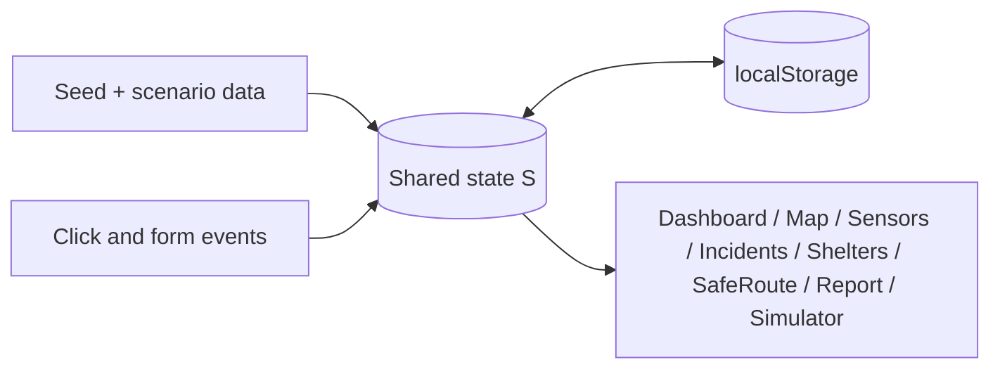

# RescueGrid

**See the risk. Coordinate the response.**

A disaster-response coordination prototype built for **IEEE Technothon 2026** (theme: *Designing for Disaster*).

> **All data is simulated.** Sensor readings, incidents, shelter capacities, map locations and routes are fictional demo data for the made-up "Kestrel Valley". RescueGrid is not connected to any emergency service, sensor network or routing provider. Routes are illustrative and unverified. In a real emergency, contact your local emergency number.

## Problem
In floods, information on hazards, blocked roads, shelters and supplies is fragmented, which slows coordination.

## Solution
One interface that combines simulated water-level sensors, community reports, a hazard map, shelter status and resource gaps, so responders can see where risk is highest and what needs attention first.

## Features
- **Command dashboard**: scenario status, key metrics, hazard map, water-level trend, severity distribution, priorities, activity feed, recent incidents
- **Hazard map**: layer toggles, legend, severity filter, search, zoom, incident detail panel (schematic map)
- **Sensor monitoring**: three simulated stations, thresholds (2.5 / 3.5 / 4.5 m), history chart, alert history
- **Incident management**: create, edit, delete (with confirmation), acknowledge, resolve, status workflow, filters, detail drawer
- **Shelters & resources**: editable occupancy and supplies, capacity warnings, shortage detection
- **SafeRoute**: illustrative route options with reported hazards listed (never labelled safe)
- **Community reporting**: validated form with photo preview (preview only, not stored)
- **Scenario simulator**: deterministic Baseline → Watch → Warning → Response stages that update every page together
- **Guided demo**, notifications panel, toasts, reset, local persistence (browser `localStorage`)

## Setup
No build step or dependencies. It is a single self-contained file.

```bash
git clone https://github.com/olasunkamiabdulrasheed-design/RescueGrid.git
cd RescueGrid
open index.html        # or double-click it / serve with: python3 -m http.server
```

## Two-minute demo
1. Review the dashboard baseline.
2. Press **Advance** and open **Sensors** to watch levels rise.
3. Advance to **Warning** and check new hazards on the map.
4. Submit a report in **Report**; it appears in Incidents and the dashboard.
5. Advance to **Response** and open **Shelters** to see shortages.
6. Acknowledge or resolve an incident and return to the dashboard.

Use **Reset** to start over.

## Architecture

Vanilla JavaScript, inline SVG for the map and charts, no external dependencies.

## Limitations
Schematic map, scripted sensor data, preset routes, no backend, no authentication, no real alerts. Not tested by real responders and not a certified emergency system.

## Future improvements
Real map tiles, a React/Vite rewrite with Recharts, verified data ingestion, role-based access, offline support, accessibility audit.
